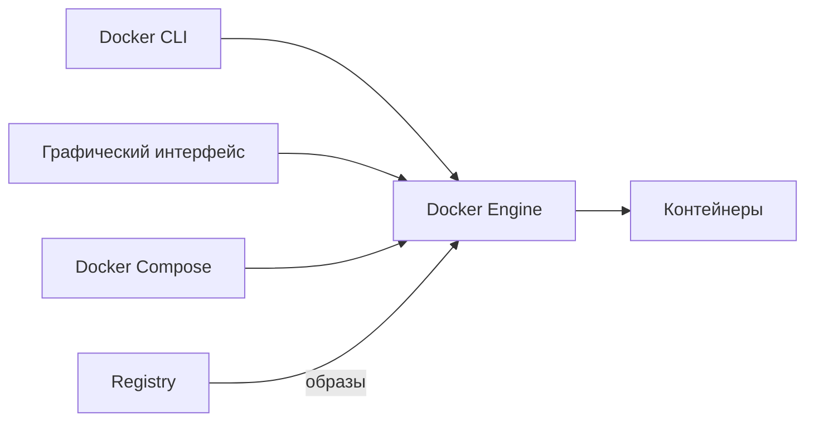
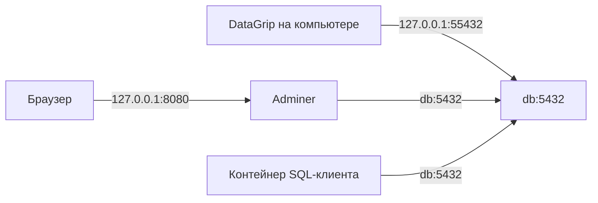
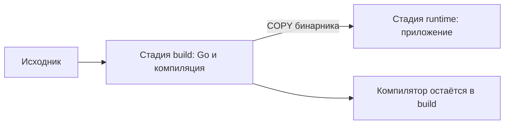

# Семинар 4. Docker: от установки до многоэтапной сборки

Методичка последовательно знакомит с устройством Docker, образами, контейнерами, сборкой и Docker Compose. Основной стенд — PostgreSQL 18 и клиенты к нему. Для изучения сборки используются небольшая программа приветствия и HTTP-сервис.

В каждом разделе есть объяснение, команды и ожидаемый результат. Сохраняйте свои наблюдения в [src/result.md](src/result.md): этот файл станет журналом экспериментов, а README — справочником для дальнейшей работы.

## Содержание

1. [Установка и устройство Docker](#1-установка-и-устройство-docker)
2. [Проверка установки и первый запуск](#2-проверка-установки-и-первый-запуск)
3. [Образы, registry, теги и слои](#3-образы-registry-теги-и-слои)
4. [Жизненный цикл контейнера](#4-жизненный-цикл-контейнера)
5. [Собственный образ и Dockerfile](#5-собственный-образ-и-dockerfile)
6. [Зачем нужен Docker Compose](#6-зачем-нужен-docker-compose)
7. [PostgreSQL и Adminer](#7-postgresql-и-adminer)
8. [Порты, сети и адреса клиентов](#8-порты-сети-и-адреса-клиентов)
9. [Хранение данных и ошибка volume](#9-хранение-данных-и-ошибка-volume)
10. [SQL и начальная инициализация](#10-sql-и-начальная-инициализация)
11. [Переменные окружения и применение настроек](#11-переменные-окружения-и-применение-настроек)
12. [Готовность сервисов и зависимости](#12-готовность-сервисов-и-зависимости)
13. [Пересоздание, удаление и резервная копия](#13-пересоздание-удаление-и-резервная-копия)
14. [Многоэтапная сборка](#14-многоэтапная-сборка)
15. [Диагностика и справочник команд](#15-диагностика-и-справочник-команд)

## 1. Установка и устройство Docker

### Какую задачу решает Docker

Приложению нужны определённая версия программы, библиотеки и настройки. При обычной установке они становятся частью окружения компьютера. Два разработчика могут получить разные версии PostgreSQL или зависимостей и разное поведение проекта.

Docker запускает программу в контейнере из заранее подготовленного образа. Например, образ PostgreSQL содержит сервер и необходимые ему файлы. Устанавливать PostgreSQL на компьютер отдельно не требуется.

**Образ** — пакет файлов и настроек для запуска. **Контейнер** — созданный из образа экземпляр с собственными процессами, сетью и состоянием. Остановленный контейнер продолжает существовать; образ может использоваться многими контейнерами.

Контейнеры используют ядро среды, в которой работает Docker Engine. На Linux Engine может работать непосредственно в ОС; для Linux-контейнеров на macOS и Windows используется Linux-среда, обычно виртуальная машина. [Контейнеры и виртуальные машины](https://docs.docker.com/get-started/docker-concepts/the-basics/what-is-a-container/).

### Из каких частей состоит окружение

| Компонент | Назначение |
| --- | --- |
| Docker Engine | Создаёт и запускает контейнеры, управляет образами, сетями и хранилищами |
| Docker CLI | Команда `docker`, которая отправляет запросы Engine |
| Docker Desktop | Приложение с графическим интерфейсом и готовым окружением Docker |
| Docker Compose | Описывает несколько сервисов в YAML и управляет ими командой `docker compose` |
| BuildKit / Buildx | Средства сборки образов из Dockerfile |
| Registry | Удалённое хранилище, из которого скачивают и в которое отправляют образы |



CLI и графический интерфейс — способы управления одним окружением. Наличие команды `docker` ещё не означает, что Engine установлен и запущен.

### Как выбрать и установить окружение

| Вариант | Где используется | Что установить |
| --- | --- | --- |
| Docker Desktop | Windows, macOS, Linux | Приложение включает CLI, Compose и окружение Engine |
| Docker Engine отдельно | Linux | Engine, CLI и плагины Compose/Buildx |
| OrbStack | macOS | Альтернативное окружение для Docker-контейнеров с графическим интерфейсом |
| Colima | macOS, Linux | Окружение контейнеров, обычно управляемое из терминала; CLI устанавливается отдельно |

Для первого знакомства удобно выбрать Docker Desktop. Если уже используется OrbStack или Colima, дальнейшие команды можно выполнять в этом окружении. Не требуется устанавливать несколько вариантов одновременно. [Docker Desktop](https://docs.docker.com/get-started/get-docker/), [OrbStack](https://docs.orbstack.dev/docker/), [Colima](https://github.com/abiosoft/colima).

**macOS:**

1. Откройте [установку Docker Desktop для Mac](https://docs.docker.com/desktop/setup/install/mac-install/).
2. Выберите установщик для Apple Silicon или Intel согласно процессору компьютера.
3. Установите приложение, запустите его и завершите первоначальную настройку.
4. Дождитесь запуска Engine, затем откройте терминал.

**Windows:**

1. Установите WSL 2 по [инструкции Microsoft](https://learn.microsoft.com/windows/wsl/install), если он ещё не установлен. После установки может потребоваться перезагрузка.
2. Установите [Docker Desktop для Windows](https://docs.docker.com/desktop/setup/install/windows-install/) с Linux-контейнерами и WSL 2.
3. Запустите Docker Desktop. В настройках WSL integration включите используемый Linux-дистрибутив.
4. Откройте терминал этого дистрибутива. Далее команды приведены для Bash/Zsh, поэтому их удобно выполнять внутри WSL.

**Linux:**

1. Выберите Docker Desktop или отдельный Docker Engine.
2. Для Engine используйте инструкцию именно своего дистрибутива: [Ubuntu](https://docs.docker.com/engine/install/ubuntu/), [остальные дистрибутивы](https://docs.docker.com/engine/install/).
3. При установке из репозитория Docker нужны пакеты Engine, CLI, `containerd`, плагин Buildx и плагин Compose.
4. Запустите службу Docker и проверьте доступ к ней. Если пользователь не имеет доступа, следуйте разделу post-installation официальной инструкции. Членство в группе `docker` даёт широкие права на управление хостом.

Для работы нужны терминал, редактор файлов и локальная папка этого репозитория. Исходники небольших программ будут приведены в тексте; устанавливать Go и PostgreSQL на компьютер не нужно.

## 2. Проверка установки и первый запуск

### Проверяем CLI

```bash
docker --version
```

Команда выводит версию клиента. Ошибка `command not found` означает, что CLI отсутствует или его каталог не входит в `PATH`. Эта проверка ещё не обращается к Engine.

### Проверяем связь с Engine

```bash
docker version
```

В результате нужны два раздела: **Client** и **Server**. Client описывает локальную команду, Server — Engine, которому она отправила запрос. Их версии могут отличаться.

Если есть Client и ошибка `Cannot connect to the Docker daemon`, проверьте, запущен ли Docker Desktop, OrbStack, Colima или служба Docker. На Linux ошибка `permission denied` может означать отсутствие доступа к socket.

### Проверяем context

**Context** — настройки подключения CLI к определённому Engine. На компьютере могут быть contexts для Docker Desktop, OrbStack и удалённого сервера. У каждого Engine собственные контейнеры, образы и volumes.

```bash
docker context ls
docker context show
```

Первая команда показывает доступные подключения и активное, вторая — только имя активного. Переключение выполняется через `docker context use ИМЯ`; используйте имя из своего списка. Если после переключения «исчезли» контейнеры, возможно, вы смотрите другой Engine. Переменные `DOCKER_HOST` и `DOCKER_CONTEXT` также могут влиять на подключение. [Docker contexts](https://docs.docker.com/engine/manage-resources/contexts/).

### Выполняем полный тест запуска

```bash
docker run --rm hello-world
```

Docker найдёт локальный образ `hello-world` или скачает его, создаст контейнер и запустит его программу. Сообщение `Hello from Docker!` подтверждает, что удалось получить образ и выполнить процесс. Программа завершается, а `--rm` удаляет завершившийся контейнер.

Здесь `run` означает **создать и запустить контейнер**, а `hello-world` — имя образа. Скачивание образа и запуск контейнера — разные операции; далее рассмотрим их отдельно.

### Где выполнять следующие команды

Откройте терминал в корне локального репозитория и проверьте текущую папку:

```bash
pwd
ls
```

В ней должны быть `README.md` и `src/`. До раздела 6 команды выполняются из корня. В разделе 6 будет переход в `src/`, после которого используем пути относительно этой папки.

Имена `hse4-*` предназначены для наших примеров. Если повторяете раздел и имя уже занято, найдите объект через `docker ps -a`: существующий контейнер можно запустить либо удалить, если его состояние больше не нужно.

## 3. Образы, registry, теги и слои

### Где брать готовые образы

**Registry** хранит образы, **repository** объединяет образы одного проекта внутри registry. Docker Hub — registry, используемый по умолчанию. У организации может быть собственный registry; образы также размещают в GitHub Container Registry и других сервисах.

На [Docker Hub](https://hub.docker.com/) найдите `postgres` и откройте [официальный образ](https://hub.docker.com/_/postgres). Перед использованием изучите описание: доступные теги, переменные, пути хранения и порядок инициализации. Требования образа PostgreSQL отличаются от требований другого сервера. [Registry и repository](https://docs.docker.com/get-started/docker-concepts/the-basics/what-is-a-registry/).

### Как читать имя образа

```text
registry/namespace/repository:tag
docker.io/library/postgres:18
ghcr.io/organization/application:1.0
```

| Часть | Значение |
| --- | --- |
| `docker.io` | Адрес registry |
| `library` | Namespace официальных образов Docker Hub |
| `postgres` | Repository образа |
| `18` | Тег, выбранный издателем образа |

Короткое `postgres:18` означает `docker.io/library/postgres:18`. Если тег не указан, подразумевается `latest`. Тег `latest` — обычная метка, а не гарантия самой новой или стабильной версии. [Имена и теги](https://docs.docker.com/reference/cli/docker/image/tag/).

### Тег и digest

| Ссылка | Что фиксирует |
| --- | --- |
| `postgres:18` | Ветку PostgreSQL; издатель обновляет образ внутри этого тега |
| Тег полной версии | Более узкую версию, но тег также может быть переназначен |
| Вариант `alpine` / `bookworm` | Вариант базового окружения, если он опубликован для выбранной версии |
| `postgres@sha256:…` | Конкретное содержимое, указанное digest |

Тег — изменяемое имя. Digest — идентификатор содержимого. Запущенный контейнер не обновится сам при изменении тега в registry: сначала получают новый образ, затем создают контейнер из него. [Загрузка образов и digest](https://docs.docker.com/reference/cli/docker/image/pull/).

В методичке используется одна ветка PostgreSQL — `18`. Фактическую версию сервера позже проверим SQL-командой.

### Скачиваем образ без запуска

Для первых опытов используем Alpine — небольшой Linux-образ с shell и базовыми утилитами.

```bash
docker pull alpine:3.21
docker image ls
docker image inspect alpine:3.21 --format '{{json .RepoDigests}}'
docker image inspect alpine:3.21 --format 'os={{.Os}} arch={{.Architecture}}'
```

| Команда | Что произошло |
| --- | --- |
| `pull` | Образ загружен в выбранный Engine; контейнер не создан |
| `image ls` | Показаны локальные образы, теги, ID и размеры |
| `image inspect` | Получены метаданные образа, здесь digest и платформа |

Для многоархитектурного образа Docker обычно выбирает вариант под платформу Engine. Apple Silicon и Intel могут получить разные платформенные образы под одним тегом. Принудительный `--platform linux/amd64` на ARM может потребовать эмуляцию. [Платформы образов](https://docs.docker.com/build/building/multi-platform/).

### Из чего состоит образ

Образ содержит **слои изменений файловой системы** и конфигурацию запуска. Слои добавляют, меняют или удаляют файлы. Они неизменяемы и могут повторно использоваться разными образами. При скачивании Docker получает недостающие слои.

```bash
docker image history alpine:3.21
docker image inspect alpine:3.21 --format '{{json .RootFS.Layers}}'
```

`history` показывает историю сборки и размеры изменений; `.RootFS.Layers` — идентификаторы слоёв файловой системы. Не каждая строка history означает новый слой с файлами: настройки `CMD`, `ENV` и другие метаданные тоже входят в историю.

При создании контейнера поверх образа появляется собственный записываемый слой. Изменения в контейнере не изменяют исходный образ. Хранилища volume и bind mount подключаются отдельно; их изучим после запуска Compose. [Слои образа](https://docs.docker.com/get-started/docker-concepts/building-images/understanding-image-layers/).

## 4. Жизненный цикл контейнера

### Что означает docker run

```text
docker run [параметры Docker] ОБРАЗ [команда внутри контейнера] [её аргументы]
```

Параметры Docker находятся перед именем образа. Всё после образа относится к запускаемой программе с учётом `ENTRYPOINT` этого образа. Поэтому `-d` перед образом и `-d` после образа могут иметь разный смысл.

`run` создаёт новый контейнер. Он использует локальный образ или скачивает отсутствующий. Для повторного запуска существующего контейнера используется `start`.

### Запускаем короткий процесс

```bash
docker run --name hse4-once alpine:3.21 echo "hello from container"
docker ps
docker ps -a --filter name=hse4-once
docker inspect hse4-once --format '{{.State.Status}} exit={{.State.ExitCode}}'
docker logs hse4-once
```

`echo` вывел строку и завершился. Контейнер находится в состоянии `exited` с кодом `0`: программа успешно выполнила работу. `ps` показывает работающие контейнеры, `ps -a` включает остановленные. `logs` возвращает вывод программы в stdout/stderr.

```bash
docker start -a hse4-once
docker rm hse4-once
```

`start -a` повторно запускает главную команду и подключает её вывод к терминалу. `rm` удаляет остановленный контейнер. Имя освобождается только после удаления.

### Запускаем долгий процесс в фоне

```bash
docker run -d --name hse4-life alpine:3.21 sleep 86400
docker ps --filter name=hse4-life
docker top hse4-life
```

`sleep` работает до суток или до остановки контейнера. `-d` запускает контейнер в фоне и освобождает терминал. Выведенный ID подтверждает создание контейнера; работоспособность программы проверяют отдельно.

Контейнер живёт, пока работает его главный процесс. Завершение этого процесса останавливает контейнер. Фоновый режим Docker не превращает короткую программу в постоянно работающий сервис.

### Выполняем дополнительную команду

```bash
docker exec hse4-life pwd
docker exec -it hse4-life sh
```

`exec` запускает дополнительный процесс внутри **работающего** контейнера. В открывшемся shell выполните:

```sh
pwd
ls
exit
```

После `exit` проверьте:

```bash
docker ps --filter name=hse4-life
```

Контейнер продолжает работать: завершился дополнительный shell, а главный `sleep` остался.

| Параметр | Назначение |
| --- | --- |
| `--name` | Задаёт имя контейнера |
| `-d` | Запускает в фоне |
| `-i` | Оставляет stdin открытым, нужен для передачи ввода |
| `-t` | Выделяет псевдотерминал для интерактивной работы |
| `--rm` | Удаляет контейнер после завершения |

### Останавливаем и запускаем существующий контейнер

```bash
docker stop hse4-life
docker ps -a --filter name=hse4-life
docker start hse4-life
docker restart hse4-life
```

`stop` останавливает главный процесс, но сохраняет контейнер и его настройки. `start` использует эти же настройки. `restart` выполняет остановку и запуск. Изменить образ, публикацию порта или mount обычным `start` нельзя: для этого создают новый контейнер.

`hse4-life` оставьте работающим для раздела о хранении данных.

### Как читать состояние

| Состояние | Значение |
| --- | --- |
| `created` | Контейнер создан, главный процесс ещё не запущен |
| `running` | Главный процесс работает |
| `exited` | Главный процесс завершился |
| `restarting` | Docker пытается перезапустить контейнер согласно политике restart |
| `paused` | Выполнение процессов приостановлено |

Код `0` обычно означает успешное завершение. Ненулевой код требует чтения сообщения программы и логов. Код `137` связан с SIGKILL, но сам по себе не доказывает нехватку памяти: причину проверяют отдельно через `.State.OOMKilled` и другие данные.

[Запуск контейнеров](https://docs.docker.com/engine/containers/run/).

## 5. Собственный образ и Dockerfile

### Зачем собирать образ

Готовый образ содержит общие инструменты. Собственный образ добавляет файлы вашего приложения и задаёт способ запуска. Dockerfile описывает эту сборку так, чтобы её можно было повторить на другом компьютере.

Начнём с программы приветствия. Создайте каталог:

```bash
mkdir -p src/lab/hello
```

Создайте `src/lab/hello/greet.sh` с окончаниями строк LF:

```sh
#!/bin/sh
printf '%s, %s!\n' "$GREETING" "$1"
```

Программа печатает приветствие из окружения и имя из первого аргумента.

### Описываем сборку

Создайте `src/lab/hello/Dockerfile`:

```dockerfile
FROM alpine:3.21
WORKDIR /app
COPY greet.sh /app/greet.sh
RUN chmod +x /app/greet.sh
ARG APP_VERSION=1.0
RUN printf '%s\n' "$APP_VERSION" > /app/version.txt
ENV GREETING=Hello
ENTRYPOINT ["/app/greet.sh"]
CMD ["student"]
```

| Инструкция | Что происходит |
| --- | --- |
| `FROM` | Выбирается базовый образ |
| `WORKDIR` | Устанавливается рабочий каталог последующих команд |
| `COPY` | Файл из контекста сборки копируется в образ |
| `RUN` | Команда выполняется во время сборки |
| `ARG` | Объявляется параметр сборки |
| `ENV` | Задаётся значение окружения по умолчанию для контейнера |
| `ENTRYPOINT` | Задаётся исполняемая программа контейнера |
| `CMD` | Задаются аргументы по умолчанию для этой программы |

`RUN chmod` выполняется при сборке. `/app/greet.sh` выполняется при запуске контейнера. В данном Dockerfile результат запуска — программа из `ENTRYPOINT` с аргументом из `CMD`.

### Контекст сборки и .dockerignore

**Контекст** — каталог файлов, доступных сборщику. `COPY` читает пути относительно контекста, а не относительно текущего рабочего каталога shell или расположения Dockerfile, выбранного через `-f`.

Создайте `src/lab/hello/.dockerignore`:

```text
.git
.env
secrets/
*.tar
```

Эти файлы исключаются из контекста. Здесь контекстом будет только `src/lab/hello/`; файл из соседнего `src/` нельзя скопировать через `COPY ../...`. [Контекст сборки](https://docs.docker.com/build/concepts/context/).

### Собираем и запускаем

```bash
docker build --progress=plain -t hse4-hello:v1 src/lab/hello
docker image ls hse4-hello
docker run --rm hse4-hello:v1
```

`build` создаёт образ. `-t` присваивает имя и тег, `--progress=plain` показывает шаги сборки, последний аргумент задаёт контекст. Ожидаемый вывод контейнера — `Hello, student!`.

### CMD, ENTRYPOINT и ENV на практике

```bash
docker run --rm hse4-hello:v1 Docker
docker run --rm -e GREETING=Welcome hse4-hello:v1 Docker
docker run --rm --entrypoint cat hse4-hello:v1 /app/version.txt
docker image inspect hse4-hello:v1 --format 'entrypoint={{json .Config.Entrypoint}} cmd={{json .Config.Cmd}}'
```

| Запуск | Результат |
| --- | --- |
| Без аргумента | `Hello, student!` |
| С аргументом `Docker` | `Hello, Docker!`: аргумент заменил `CMD` |
| С `-e GREETING=Welcome` | `Welcome, Docker!`: изменено окружение экземпляра |
| С `--entrypoint cat` | `1.0`: выбрана другая программа |

`ARG` сам по себе не становится переменной окружения работающего контейнера. В примере его значение было записано в файл при сборке. `ENV` задаёт runtime-значение по умолчанию, которое можно переопределить через `-e`.

JSON-запись `ENTRYPOINT`/`CMD` запускает программу без дополнительного shell. Если использовать shell-запись, обработка аргументов и сигналов меняется. В образе PostgreSQL entrypoint выполняет подготовку БД, поэтому его замена может отключить инициализацию. [Dockerfile](https://docs.docker.com/reference/dockerfile/).

### Слои и кэш сборки

```bash
docker image history hse4-hello:v1
docker build --progress=plain -t hse4-hello:v1 src/lab/hello
```

Во второй сборке неизменённые шаги обычно отмечены `CACHED`. Измените текст приветствия в `greet.sh` и соберите снова. Изменится `COPY`, и последующие зависимые шаги потребуют повторного выполнения. Верните исходный файл и пересоберите перед продолжением.

Затем измените параметр сборки:

```bash
docker build --build-arg APP_VERSION=2.0 -t hse4-hello:v2 src/lab/hello
docker run --rm --entrypoint cat hse4-hello:v2 /app/version.txt
```

Ожидается `2.0`. Базовые слои и шаги до использования изменившегося аргумента могут повторно использоваться. Сборка нового тега не меняет контейнеры и образы с прежним содержимым.

| Параметр сборки | Назначение |
| --- | --- |
| `-t` | Имя и тег результата |
| `-f` | Выбор Dockerfile; контекст задаётся отдельно |
| `--build-arg` | Передача значения `ARG` |
| `--no-cache` | Отказ от использования кэша шагов |
| `--pull` | Проверка обновления базового образа |
| `--target` | Сборка определённой стадии многоэтапного Dockerfile |

Кэш ускоряет сборку, но не отслеживает произвольные изменения внешних сайтов. Неизменённый `RUN` с загрузкой пакетов может получить кэшированный результат. Секреты не передавайте через `ARG` или `ENV` сборки. [Кэш сборки](https://docs.docker.com/build/cache/invalidation/).

### Как передать образ другому разработчику

Есть два способа: отправить образ в registry или сохранить в архив.

Для публикации в своём Docker Hub repository замените `your-dockerhub-user` своим namespace:

```bash
docker login
docker tag hse4-hello:v1 your-dockerhub-user/hse4-hello:v1
docker push your-dockerhub-user/hse4-hello:v1
```

`tag` добавляет ссылку на локальный образ и ничего не загружает в сеть. `push` отправляет его в registry; другой компьютер может получить образ через `pull`. Видимость repository определяет, кто имеет доступ к опубликованному образу. Для этого способа нужен аккаунт и доступ к выбранному namespace.

Для передачи архивом:

```bash
docker image save -o hse4-hello.tar hse4-hello:v1
docker image load -i hse4-hello.tar
```

Архив содержит образ, а не данные подключённых volumes. Перенос данных PostgreSQL рассмотрим отдельно. Архив не добавляйте в Git.

## 6. Зачем нужен Docker Compose

### От контейнера к проекту

Для одного процесса достаточно `docker run`. Проект может включать базу, приложение, веб-интерфейс и вспомогательные команды. При ручном запуске приходится согласовывать параметры, сети и порядок действий.

Compose хранит описание проекта в YAML: из каких образов создавать сервисы, как их собирать и с какими настройками запускать. Команда `up` сопоставляет описание с текущими контейнерами и создаёт или пересоздаёт их по необходимости. Compose работает через тот же Engine, что и обычные команды Docker.

**Сервис** — описание компонента проекта. **Контейнер** — его конкретный экземпляр. В командах Compose используют имя сервиса из YAML. [Устройство Compose](https://docs.docker.com/compose/).

### Проверяем Compose

```bash
docker compose version
```

Должна отображаться версия Compose. В Docker Desktop он входит в комплект; при отдельной установке Engine нужен плагин Compose. В методичке используется команда `docker compose`.

### Описываем знакомую программу

Перейдите из корня репозитория в `src/`:

```bash
cd src
```

До конца методички выполняйте команды из этой папки. Создайте `compose.hello.yml`:

```yaml
name: hse4-hello
services:
  greet:
    image: hse4-hello:v1
    build:
      context: ./lab/hello
    command: ["Compose"]
```

| Поле | Назначение |
| --- | --- |
| `name` | Имя проекта и префикс его ресурсов |
| `services` | Словарь сервисов |
| `greet` | Имя нашего сервиса |
| `image` | Имя образа сервиса; здесь также имя результата сборки |
| `build.context` | Каталог сборки с Dockerfile |
| `command` | Замена `CMD`; `ENTRYPOINT` образа сохраняется |

YAML использует отступы пробелами. Относительный `context` считается от каталога Compose-файла. Файл `compose.hello.yml` имеет отдельное имя, поэтому выбираем его через `-f`.

```bash
docker compose -f compose.hello.yml config --quiet
docker compose -f compose.hello.yml build
docker compose -f compose.hello.yml run --rm greet
```

`config --quiet` проверяет разбор конфигурации. `build` собирает образ по её описанию. `run` создаёт одноразовый контейнер сервиса. Ожидаемый результат — `Hello, Compose!`.

Compose не превращает программу приветствия в сервер: после выполнения она завершится. Постоянно работающие сервисы появятся в следующем разделе.

## 7. PostgreSQL и Adminer

### Выбираем готовые образы

Используем [PostgreSQL 18](https://hub.docker.com/_/postgres) и [Adminer](https://hub.docker.com/_/adminer). PostgreSQL хранит данные и выполняет SQL. Adminer предоставляет веб-интерфейс, который подключается к серверу PostgreSQL.

```bash
docker pull postgres:18
docker pull adminer:5
```

`pull` позволяет получить образы заранее. Без него Compose скачает отсутствующий образ при запуске. Здесь используется одна ветка PostgreSQL — `18`.

Перед созданием конфигурации разберём необходимые поля:

| Поле сервиса | Назначение |
| --- | --- |
| `image` | Готовый образ для запуска |
| `environment` | Переменные окружения процесса внутри контейнера |
| `ports` | Публикация порта контейнера на компьютере |

У официального образа PostgreSQL переменные `POSTGRES_*` задают **начальную** подготовку пустой базы:

| Переменная | Назначение |
| --- | --- |
| `POSTGRES_USER` | Имя создаваемой роли PostgreSQL; образ создаёт её с правами superuser |
| `POSTGRES_PASSWORD` | Пароль этой роли при первоначальной инициализации |
| `POSTGRES_DB` | Имя создаваемой базы |

Роль `student` в PostgreSQL и пользователь Linux внутри контейнера — разные сущности. Для учебного стенда задаём демонстрационный пароль `student`.

### Создаём минимальный стенд

Создайте `src/docker-compose.yml`. Так как терминал уже находится в `src/`, это файл `docker-compose.yml` текущей папки:

```yaml
name: hse4
services:
  db:
    image: postgres:18
    environment:
      POSTGRES_USER: student
      POSTGRES_PASSWORD: student
      POSTGRES_DB: mydb
    ports:
      - "127.0.0.1:55432:5432"

  adminer:
    image: adminer:5
    environment:
      ADMINER_DEFAULT_SERVER: db
    ports:
      - "127.0.0.1:8080:8080"
```

В первой публикации `55432` — порт компьютера, `5432` — порт PostgreSQL внутри контейнера. Во второй `8080` компьютера ведёт к веб-серверу Adminer. `127.0.0.1` ограничивает публикацию локальным адресом.

Поле `version: '3.8'` не добавляем: современный Compose использует Compose Specification. `container_name` тоже не нужен — Compose создаст имена с префиксом проекта. [Compose Specification](https://docs.docker.com/reference/compose-file/).

### Запускаем и наблюдаем

| Команда | Назначение |
| --- | --- |
| `config --quiet` | Проверить YAML и поля Compose |
| `up -d` | Создать/запустить сервисы в фоне |
| `ps -a` | Посмотреть контейнеры проекта, включая остановленные |
| `logs db` | Прочитать вывод PostgreSQL |

```bash
docker compose config --quiet
docker compose up -d
docker compose ps -a
docker compose logs --tail 60 db
```

`db` и `adminer` должны работать. Создание контейнеров занимает меньше времени, чем полная инициализация базы: статус running ещё не означает готовность SQL.

### Проверяем готовность и выполняем SQL

`pg_isready` находится в образе PostgreSQL и проверяет, принимает ли сервер соединения. `-h` задаёт адрес, `-U` — роль, `-d` — базу.

```bash
docker compose exec db pg_isready -h 127.0.0.1 -U student -d mydb
```

Если сервер ещё не готов, повторите команду до `accepting connections`. `compose exec db` выполняет команду в уже работающем контейнере сервиса `db`.

```bash
docker compose exec db psql -U student -d mydb -c 'SELECT version();'
```

`psql` — SQL-клиент, `-c` — запрос для выполнения. Полученная версия относится к серверу PostgreSQL, а не к Docker или Compose.

Пока мы не задали именованный volume. Официальный образ подключает анонимное хранилище автоматически; явное управление данными добавим до создания таблиц в разделе 9.

## 8. Порты, сети и адреса клиентов

### Порт контейнера и порт компьютера

Программа слушает порт в собственной сетевой среде. У двух контейнеров PostgreSQL могут быть одинаковые внутренние порты. Конфликт возникает, если они пытаются опубликовать один и тот же адрес и порт компьютера.

```text
127.0.0.1:55432:5432
адрес компьютера : порт компьютера : порт контейнера
```

В `docker run` публикацию задаёт `-p`, в Compose — `ports`. `EXPOSE` в Dockerfile лишь описывает порт и не создаёт публикацию. [Публикация портов](https://docs.docker.com/engine/network/port-publishing/).

```bash
docker compose port db 5432
```

Ожидается `127.0.0.1:55432`. Если этот порт занят на компьютере, измените **левый** порт публикации и настройки клиента. Внутри контейнера PostgreSQL продолжит слушать `5432`.

### Сеть Compose и DNS

Compose создал сеть `hse4_default` и подключил к ней сервисы. В общей сети имя `db` разрешается в адрес контейнера PostgreSQL. IP может измениться при пересоздании, поэтому клиенты используют имя сервиса.

```bash
docker network ls
docker network inspect hse4_default --format '{{json .Containers}}'
```

Порты `db:5432` и `127.0.0.1:55432` предназначены для клиентов из разных мест. [Сети Compose](https://docs.docker.com/compose/how-tos/networking/).



### Подключаем DataGrip

Создайте источник данных PostgreSQL:

| Поле | Значение |
| --- | --- |
| Host | `127.0.0.1` |
| Port | `55432` |
| Database | `mydb` |
| User | `student` |
| Password | `student` |

Выполните **Test Connection**. При первом подключении загрузите драйвер. Откройте SQL-консоль и выполните `SELECT 1;`.

Если локальный `psql` уже установлен, можно подключиться им: `psql -h 127.0.0.1 -p 55432 -U student -d mydb`. Устанавливать его специально для методички не требуется.

### Подключаем Adminer и проверяем localhost

Откройте [Adminer](http://127.0.0.1:8080) в браузере:

| Поле | Значение |
| --- | --- |
| System | PostgreSQL |
| Server | `db` |
| Username | `student` |
| Password | `student` |
| Database | `mydb` |

Выполните `SELECT 1;`. Затем выйдите из подключения, замените Server на `localhost` и попробуйте подключиться ещё раз. Должна возникнуть ошибка. Верните `db`.

SQL-соединение открывает серверный процесс **в контейнере Adminer**. Для него `localhost` указывает на сам Adminer. Браузер лишь показывает интерфейс.

| Откуда подключается клиент | Адрес PostgreSQL |
| --- | --- |
| Компьютер: DataGrip или локальный psql | `127.0.0.1:55432` |
| Контейнер в сети `hse4_default` | `db:5432` |
| Процесс внутри контейнера db | `127.0.0.1:5432` или локальный Unix socket |

### Запускаем отдельный SQL-клиент

Используем тот же образ PostgreSQL, но запускаем из него `psql`, а не сервер:

```bash
docker run --rm --network hse4_default -e PGPASSWORD=student postgres:18 psql -h db -U student -d mydb -c 'SELECT 1;'
```

`--network` подключает новый контейнер к существующей сети. `PGPASSWORD` передаёт пароль клиенту. `psql` после имени образа заменяет стандартную команду запуска; entrypoint образа допускает такой режим. После запроса контейнер удаляется.

`docker compose exec db psql ...` без `-h` использует Unix socket. В официальном образе такое локальное подключение может работать без пароля. Проверка правильности сетевого пароля выполняется через DataGrip, Adminer или отдельный TCP-клиент.

### Убираем публикацию PostgreSQL

Удалите `ports` только у `db`, выполните `docker compose up -d`. Новое подключение DataGrip перестанет работать, а Adminer продолжит использовать `db:5432`. Это показывает, что связь контейнеров внутри сети не требует публикации порта на компьютере.

Верните `ports`, выполните `docker compose up -d` и снова подключитесь DataGrip.

## 9. Хранение данных и ошибка volume

### Почему данные нужно рассматривать отдельно

У контейнера есть записываемый слой. Он сохраняется при остановке и удаляется вместе с контейнером. Имя контейнера не является именем его данных: новый экземпляр с прежним именем не получает старый слой автоматически.

Вернёмся к работающему `hse4-life` из раздела 4:

```bash
docker exec hse4-life sh -c 'echo "created inside" > /note.txt'
docker stop hse4-life
docker start hse4-life
docker exec hse4-life cat /note.txt
docker diff hse4-life
```

Файл сохранился после остановки. `diff` показывает изменения в файловой системе контейнера: `A` — добавлено, `C` — изменено, `D` — удалено.

```bash
docker stop hse4-life
docker rm hse4-life
docker run -d --name hse4-life alpine:3.21 sleep 86400
docker exec hse4-life cat /note.txt
```

Теперь файла нет. Повторно использован образ, но создан другой контейнер.

### Именованный volume

**Volume** — отдельное хранилище, которым управляет Docker. Его жизненный цикл отделён от контейнера. Несколько последовательных контейнеров могут подключить один volume и увидеть те же файлы.

```bash
docker volume create hse4-notes
docker run --rm --mount type=volume,source=hse4-notes,target=/data alpine:3.21 sh -c 'echo "saved in volume" > /data/note.txt'
docker run --rm --mount type=volume,source=hse4-notes,target=/data alpine:3.21 cat /data/note.txt
docker volume inspect hse4-notes
```

`source` — имя хранилища, `target` — путь подключения внутри контейнера. Первый контейнер записал файл, второй прочитал его. Удаление контейнера через `--rm` не удаляет именованный volume.

`Mountpoint` в inspect относится к машине Engine. На macOS/Windows это обычно путь внутри Linux-среды, а не обычная папка вашей основной ОС. [Volumes](https://docs.docker.com/engine/storage/volumes/).

### Bind mount

**Bind mount** подключает существующий файл или каталог компьютера. Он удобен для исходников, SQL и конфигурации, которые требуется редактировать снаружи контейнера.

```bash
mkdir -p lab/share
```

Создайте `lab/share/message.txt` с текстом `first version`, затем выполните:

```bash
docker run --rm --mount "type=bind,source=$PWD/lab/share,target=/share,readonly" alpine:3.21 cat /share/message.txt
```

Измените текст в редакторе и повторите команду. Новый текст появляется без сборки образа. Проверим режим чтения:

```bash
docker run --rm --mount "type=bind,source=$PWD/lab/share,target=/share,readonly" alpine:3.21 sh -c 'echo change > /share/message.txt'
```

Запись должна завершиться ошибкой. `readonly`, или `:ro` в короткой записи Compose, запрещает запись через этот mount.

Подключённый каталог скрывает содержимое образа в точке подключения. `--mount type=bind` требует существующий исходный путь; краткое `-v` при опечатке может создать каталог. В случае удалённого Engine исходный путь относится к его хосту. [Bind mounts](https://docs.docker.com/engine/storage/bind-mounts/).

| Хранение | После stop/start | После удаления контейнера | Использование |
| --- | --- | --- | --- |
| Записываемый слой | Сохраняется | Удаляется | Изменения конкретного экземпляра |
| Именованный volume | Сохраняется | Сохраняется до удаления volume | Данные PostgreSQL |
| Bind mount | Остаётся на хосте | Остаётся на хосте | Редактируемые файлы проекта |
| tmpfs | В памяти | Не сохраняется | Временные данные; не подходит для постоянной базы |

### Добавляем именованный volume PostgreSQL

До создания таблиц измените основной `docker-compose.yml`: у сервиса `db` добавьте mount, а на верхнем уровне объявите ресурс.

```yaml
    volumes:
      - pgdata:/var/lib/postgresql
```

```yaml
volumes:
  pgdata:
```

Первый фрагмент должен находиться **внутри `db`**, второй — на уровне `services`. Не путайте объявление хранилища и его подключение.

```bash
docker compose config --quiet
docker compose up -d db
docker compose exec db pg_isready -h 127.0.0.1 -U student -d mydb
docker volume inspect hse4_pgdata
docker inspect "$(docker compose ps -q db)" --format '{{json .Mounts}}'
```

При необходимости повторите проверку готовности. Теперь сервер использует `hse4_pgdata`. До этого использовалось анонимное хранилище: его данные не переносятся в новый именованный volume автоматически. На этом этапе мы ещё не создавали учебные таблицы.

Существование PostgreSQL-данных в volume объясняет, почему нельзя делать общий вывод «после удаления контейнера любая база теряется». Проверяйте реальные `.Mounts` и способ повторного подключения.

### Ошибка пути в PostgreSQL 18

У официального образа PostgreSQL 18 стандартный каталог данных — `/var/lib/postgresql/18/docker`, а точка подключения volume — `/var/lib/postgresql`. Старый путь `/var/lib/postgresql/data` из примеров для предыдущих версий не соответствует этой раскладке. [Dockerfile PostgreSQL 18](https://github.com/docker-library/postgres/blob/master/18/trixie/Dockerfile).

Воспроизведите ошибку в отдельном проекте. Создайте `compose.bad-volume.yml`:

```yaml
name: hse4-bad-volume
services:
  db:
    image: postgres:18
    environment:
      POSTGRES_PASSWORD: student
    volumes:
      - bad-data:/var/lib/postgresql/data
volumes:
  bad-data:
```

```bash
docker compose -f compose.bad-volume.yml config --quiet
docker compose -f compose.bad-volume.yml up -d
docker compose -f compose.bad-volume.yml ps -a
docker compose -f compose.bad-volume.yml logs --tail 80 db
docker inspect "$(docker compose -f compose.bad-volume.yml ps -a -q db)" --format '{{.State.Status}} exit={{.State.ExitCode}} mounts={{json .Mounts}}'
```

YAML корректен: Compose проверил его структуру, но не требования приложения к каталогу данных. Контейнер создаётся, затем entrypoint PostgreSQL завершает работу с ошибкой. В логах ищите `/var/lib/postgresql/data`, `unused mount/volume` и рекомендацию монтировать `/var/lib/postgresql`. Точный текст зависит от обновления образа. [Обработка ошибки](https://github.com/docker-library/postgres/blob/master/docker-entrypoint.sh).

Исправьте mount на `bad-data:/var/lib/postgresql` и повторите:

```bash
docker compose -f compose.bad-volume.yml up -d
docker compose -f compose.bad-volume.yml exec db pg_isready -h 127.0.0.1 -U postgres -d postgres
```

Здесь не задан `POSTGRES_USER`, поэтому используются роль и база `postgres`. Обычный `start` или `restart` не исправил бы mount: нужно пересоздать контейнер с новой конфигурацией через `up`.

После фиксации результата удалите только отдельный учебный проект:

```bash
docker compose -f compose.bad-volume.yml down -v
```

Опыт использует пустое хранилище. Если volume содержит настоящую базу старого формата, изменение пути само по себе не выполняет миграцию версии PostgreSQL.

## 10. SQL и начальная инициализация

### Создаём воспроизводимые данные

В основном проекте `hse4` уже есть именованный volume. Создайте каталог для SQL:

```bash
mkdir -p lab/init
```

Создайте `lab/init/10-schema.sql`:

```sql
CREATE TABLE users (
    id bigint GENERATED ALWAYS AS IDENTITY PRIMARY KEY,
    name text NOT NULL,
    age integer NOT NULL CHECK (age BETWEEN 0 AND 99)
);
```

Создайте `lab/init/20-seed.sql`:

```sql
INSERT INTO users (name, age)
SELECT
    CASE WHEN n % 5 = 0 THEN 'Alice_' ELSE 'User_' END || n,
    (n % 100)::integer
FROM generate_series(1, 10000) AS s(n);
```

Данные детерминированы: результат проверки будет одинаковым при каждом создании новой базы.

### Передаём SQL в работающую базу

```bash
docker compose exec -T db psql -U student -d mydb -v ON_ERROR_STOP=1 < lab/init/10-schema.sql
docker compose exec -T db psql -U student -d mydb -v ON_ERROR_STOP=1 < lab/init/20-seed.sql
```

| Часть команды | Назначение |
| --- | --- |
| `exec -T` | Выполнить команду без псевдотерминала, удобно для передачи файла |
| `psql` | Прочитать SQL из stdin и выполнить его |
| `-v ON_ERROR_STOP=1` | Остановить обработку при SQL-ошибке |
| `< lab/init/...` | Shell на компьютере открывает файл и передаёт его содержимое программе |

Если использовать обычный `docker exec`, для передачи stdin нужен `-i`. У Compose поведение ввода отличается, поэтому здесь используется `exec -T`.

Схему и seed выполняйте один раз на новой базе. Повторный `CREATE TABLE` сообщит о существующей таблице; повторный seed добавит ещё 10 000 строк.

### Проверяем SQL

```bash
docker compose exec db psql -U student -d mydb
```

Внутри `psql` выполните:

```sql
SELECT version();
SHOW data_directory;
SELECT count(*) FROM users;
SELECT count(*) FROM users WHERE age > 50;
SELECT count(*) FROM users WHERE name LIKE 'A%';
SELECT * FROM users ORDER BY id LIMIT 5;
```

| Проверка | Ожидаемый результат |
| --- | --- |
| Количество строк | 10000 |
| Возраст больше 50 | 4900 |
| Имя начинается с A | 2000 |
| Каталог данных | `/var/lib/postgresql/18/docker` |

Создайте маркер для будущей проверки сохранности:

```sql
INSERT INTO users (name, age)
SELECT 'Docker_marker', 42
WHERE NOT EXISTS (SELECT 1 FROM users WHERE name = 'Docker_marker');
SELECT count(*) FROM users;
```

Ожидается 10 001 строка. Маркер не меняет два отфильтрованных количества. Для выхода из `psql` введите `\q`.

Повторите проверки через DataGrip или Adminer. Все клиенты должны видеть одну и ту же таблицу основного сервера.

### Автоматическая подготовка новой базы

Официальный образ PostgreSQL выполняет файлы из `/docker-entrypoint-initdb.d` при первоначальной инициализации **пустого** каталога данных. Имена `10-...`, `20-...` задают порядок: сначала схема, затем данные.

Добавьте к `volumes` сервиса `db` ещё один mount:

```yaml
    volumes:
      - pgdata:/var/lib/postgresql
      - ./lab/init:/docker-entrypoint-initdb.d:ro
```

```bash
docker compose up -d db
docker compose logs --tail 60 db
```

В существующем volume база уже подготовлена, поэтому SQL не выполнится заново. Количество остаётся 10 001, маркер сохраняется. При создании пустого volume образ создаст таблицу и 10 000 строк автоматически; проверим это при работе с backup.

Init-скрипты — первоначальная подготовка. Последующие изменения схемы применяют отдельно, обычно миграциями. Если init-скрипт завершился с ошибкой, volume может остаться частично инициализированным: restart не гарантирует повторное выполнение всех файлов. [Инициализация PostgreSQL](https://hub.docker.com/_/postgres).

## 11. Переменные окружения и применение настроек

### Какие настройки вынести из YAML

Порты и параметры запуска удобно хранить отдельно, чтобы менять локальное окружение без правки структуры сервисов. Создайте `.env.example` в `src/`:

```dotenv
POSTGRES_USER=student
POSTGRES_PASSWORD=student
POSTGRES_DB=mydb
PG_PORT=55432
ADMINER_PORT=8080
```

Скопируйте его в локальный файл:

```bash
cp .env.example .env
```

`.env.example` содержит учебные значения для воспроизведения, `.env` — локальную конфигурацию. В корневой `.gitignore` добавьте `src/.env`, `src/backup.sql`, `src/secrets/` и `*.tar`. Реальные секреты не сохраняйте в Git. `config` и `inspect` могут показывать окружение.

### Подстановка переменных

Замените значения в основном Compose-файле на подстановки:

```yaml
    environment:
      POSTGRES_USER: ${POSTGRES_USER:-student}
      POSTGRES_PASSWORD: ${POSTGRES_PASSWORD:?Set POSTGRES_PASSWORD in .env}
      POSTGRES_DB: ${POSTGRES_DB:-mydb}
    ports:
      - "127.0.0.1:${PG_PORT:-55432}:5432"
```

Для `adminer` задайте публикацию:

```yaml
    ports:
      - "127.0.0.1:${ADMINER_PORT:-8080}:8080"
```

`${VAR}` означает подстановку значения. `${VAR:-default}` задаёт значение при отсутствии или пустой переменной. `${VAR:?message}` останавливает разбор конфигурации, если обязательное значение отсутствует.

```bash
docker compose config
docker compose config --environment
PG_PORT=55439 docker compose config
```

`config` показывает итоговый YAML после подстановки. `--environment` показывает источники значений для неё. Третья команда лишь отображает вариант с портом `55439`: работающий стенд она не меняет. При подстановке значение из shell имеет приоритет над `.env`. [Подстановка в Compose](https://docs.docker.com/compose/how-tos/environment-variables/variable-interpolation/).

### .env и окружение контейнера — разные вещи

| Механизм | Когда и где действует |
| --- | --- |
| `.env` рядом с Compose-файлом | Предоставляет значения для подстановки на компьютере |
| `environment` у сервиса | Передаёт выбранные переменные в контейнер |
| `env_file` у сервиса | Передаёт переменные из указанного файла в контейнер |
| `ENV` в Dockerfile | Задаёт значения по умолчанию в образе |
| `docker run -e` / `docker compose run -e` | Переопределяет значение при создании конкретного контейнера |

Сама строка в `.env` не попадает в контейнер, если она не используется в соответствующей настройке сервиса. Для проверки добавьте `ONLY_COMPOSE=example` в `.env`, выполните `docker compose config`, затем `docker compose exec db printenv ONLY_COMPOSE`. В контейнере переменной нет; `printenv` завершится без значения с ненулевым кодом. Удалите пробную строку.

Если одновременно заданы `environment` и `env_file`, явное `environment` имеет приоритет. [Приоритет окружения](https://docs.docker.com/compose/how-tos/environment-variables/envvars-precedence/).

### Restart и применение нового окружения

Измените в `.env` только пароль на `POSTGRES_PASSWORD=student2`.

```bash
docker compose restart db
docker compose exec db printenv POSTGRES_PASSWORD
```

Результат — прежнее `student`: restart запускает существующий контейнер с его настройками. Теперь примените YAML:

```bash
docker compose up -d
docker compose exec db printenv POSTGRES_PASSWORD
docker compose exec db pg_isready -h 127.0.0.1 -U student -d mydb
```

Контейнер получит `student2`. Дождитесь готовности по TCP, затем проверьте пароль отдельным клиентом:

```bash
docker run --rm --network hse4_default -e PGPASSWORD=student2 postgres:18 psql -h db -U student -d mydb -c 'SELECT 1;'
docker run --rm --network hse4_default -e PGPASSWORD=student postgres:18 psql -h db -U student -d mydb -c 'SELECT 1;'
```

Первый запрос получит ошибку аутентификации, второй выполнится. В существующей базе роль всё ещё имеет прежний пароль: `POSTGRES_PASSWORD` действует при первоначальной инициализации, а не при каждом запуске.

Для реальной смены пароля существующей роли используют SQL `ALTER ROLE`, затем обновляют настройки клиентов. Удалять volume ради смены пароля не требуется.

Верните `.env` к `POSTGRES_PASSWORD=student` и выполните `docker compose up -d`.

### Новый init-файл не изменяет существующую схему

Создайте `lab/init/30-extra.sql`:

```sql
CREATE TABLE notes (id integer PRIMARY KEY, body text NOT NULL);
```

```bash
docker compose restart db
docker compose exec db pg_isready -h 127.0.0.1 -U student -d mydb
```

После готовности выполните:

```bash
docker compose exec db psql -U student -d mydb -c "SELECT to_regclass('public.notes');"
docker compose logs --tail 40 db
```

Ожидается `NULL`: init пропущен для существующей базы. Файл виден через bind mount, но не выполняется автоматически. Примените его явно:

```bash
docker compose exec -T db psql -U student -d mydb -v ON_ERROR_STOP=1 < lab/init/30-extra.sql
docker compose exec db psql -U student -d mydb -c "SELECT to_regclass('public.notes');"
```

Теперь результат — `notes`.

| Изменяемое состояние | Как применяется изменение |
| --- | --- |
| Файлы приложения, включённые через COPY | Пересобрать образ и пересоздать контейнер |
| YAML, environment, ports, mounts | `docker compose up`, пересоздание при изменении конфигурации |
| Содержимое bind mount | Новые файлы видны без сборки; программа может требовать перечитать их |
| Роли и таблицы существующей БД | SQL-команды и миграции |

## 12. Готовность сервисов и зависимости

### Почему running недостаточно

При первом запуске PostgreSQL создаёт каталог данных, роль, базу и выполняет init. Главный процесс уже работает, но внешний SQL-клиент ещё может получить отказ в соединении.

`depends_on: [db]` задаёт порядок запуска, но не ждёт готовности запросов. Для ожидания нужен healthcheck и условие `service_healthy`. Это условие начального запуска: приложение всё равно должно уметь повторять соединение после последующих сбоев БД. [Порядок запуска](https://docs.docker.com/compose/how-tos/startup-order/).

### Что проверяет healthcheck

Healthcheck — команда внутри контейнера, по коду завершения которой Docker определяет состояние health.

| Параметр | Назначение |
| --- | --- |
| `test` | Команда проверки |
| `interval` | Интервал проверок |
| `timeout` | Допустимая длительность одной проверки |
| `retries` | Порог последовательных неудач |
| `start_period` | Период, когда начальные неудачи ещё не учитываются |

`CMD` запускает программу напрямую; `CMD-SHELL` использует shell и позволяет подставлять переменные. `$$` в Compose оставляет `$` для shell контейнера; одиночный `$` может быть обработан ещё на компьютере.

Для PostgreSQL проверяем `pg_isready` по TCP. Во время init образ временно запускает сервер только с Unix socket, поэтому проверка socket может пройти до завершения init. При этом `pg_isready` не доказывает правильность пароля или наличие таблиц: эти свойства проверяются SQL-клиентом. [pg_isready](https://www.postgresql.org/docs/18/app-pg-isready.html).

### Полная конфигурация основного стенда

Замените основной `docker-compose.yml` следующим вариантом. В нём объединены уже изученные окружение, порты и mounts; добавлены проверки готовности и одноразовый клиент.

```yaml
name: hse4

services:
  db:
    image: postgres:18
    environment:
      POSTGRES_USER: ${POSTGRES_USER:-student}
      POSTGRES_PASSWORD: ${POSTGRES_PASSWORD:?Set POSTGRES_PASSWORD in .env}
      POSTGRES_DB: ${POSTGRES_DB:-mydb}
    ports:
      - "127.0.0.1:${PG_PORT:-55432}:5432"
    volumes:
      - pgdata:/var/lib/postgresql
      - ./lab/init:/docker-entrypoint-initdb.d:ro
    healthcheck:
      test: ["CMD-SHELL", "pg_isready -h 127.0.0.1 -U $${POSTGRES_USER} -d $${POSTGRES_DB}"]
      interval: 2s
      timeout: 3s
      retries: 15
      start_period: 10s
    restart: "no"

  adminer:
    image: adminer:5
    environment:
      ADMINER_DEFAULT_SERVER: db
    ports:
      - "127.0.0.1:${ADMINER_PORT:-8080}:8080"
    depends_on:
      db:
        condition: service_healthy

  client:
    image: postgres:18
    profiles: ["tools"]
    environment:
      PGUSER: ${POSTGRES_USER:-student}
      PGDATABASE: ${POSTGRES_DB:-mydb}
      PGPASSWORD: ${POSTGRES_PASSWORD:?Set POSTGRES_PASSWORD in .env}
    depends_on:
      db:
        condition: service_healthy
    command: ["psql", "-h", "db", "-c", "SELECT count(*) FROM users;"]

volumes:
  pgdata:
```

`PGUSER`, `PGDATABASE` и `PGPASSWORD` — настройки SQL-клиента. Они не создают роли или базы; этим при init занимаются `POSTGRES_*` у сервера.

```bash
docker compose config --quiet
docker compose up -d --wait --wait-timeout 90
docker compose ps -a
docker compose run --rm client
docker compose exec -T db psql -U student -d mydb -c 'SELECT 1;'
```

`--wait` ждёт состояния running/healthy в зависимости от наличия healthcheck. Для `db` проверяется готовность TCP, для Adminer без собственного healthcheck — только running.

### Одноразовые инструменты и profiles

Обычный `up` запускает `db` и `adminer`. Сервис `client` помечен профилем `tools` и пропускается. Явный `run --rm client` запускает его и необходимые зависимости; после SQL-запроса клиент завершается.

`docker compose --profile tools up -d` включает профиль. Завершившийся SQL-клиент не является неисправностью: его работа одноразовая. [Profiles](https://docs.docker.com/compose/how-tos/profiles/).

| Команда | Что создаёт или использует |
| --- | --- |
| `exec db ...` | Дополнительный процесс в существующем контейнере db |
| `run --rm client ...` | Новый одноразовый контейнер сервиса client |
| `up` | Контейнеры сервисов проекта согласно конфигурации |

У `run` порты сервиса по умолчанию не публикуются. Для SQL-клиента они не нужны. Его команду можно заменить:

```bash
docker compose run --rm client psql -h db -c 'SELECT current_user;'
```

### Воспроизводим гонку при старте

Для сравнения короткой и длинной зависимости создайте отдельный проект. Основной стенд остаётся работать.

```bash
mkdir -p lab/slow-init
```

Создайте `lab/slow-init/00-wait.sql`:

```sql
SELECT pg_sleep(12);
```

Создайте `compose.race.yml`:

```yaml
name: hse4-race
services:
  db:
    image: postgres:18
    environment:
      POSTGRES_PASSWORD: student
    volumes:
      - race-data:/var/lib/postgresql
      - ./lab/slow-init:/docker-entrypoint-initdb.d:ro
    healthcheck:
      test: ["CMD-SHELL", "pg_isready -h 127.0.0.1 -U postgres -d postgres"]
      interval: 1s
      timeout: 2s
      retries: 30
  probe:
    image: postgres:18
    environment:
      PGPASSWORD: student
    depends_on: [db]
    command: ["psql", "-h", "db", "-U", "postgres", "-d", "postgres", "-c", "SELECT 1;"]
volumes:
  race-data:
```

Запускаем в foreground. `--abort-on-container-exit` останавливает проект при завершении контейнера; `--exit-code-from probe` возвращает код результата probe.

```bash
docker compose -f compose.race.yml up --abort-on-container-exit --exit-code-from probe
docker compose -f compose.race.yml ps -a
docker compose -f compose.race.yml logs --tail 50
```

Ожидается отказ соединения: probe запускается до завершения длительного init. Замените зависимость probe:

```yaml
    depends_on:
      db:
        condition: service_healthy
```

Удалите только хранилище проекта гонки, чтобы повторить init:

```bash
docker compose -f compose.race.yml down -v
docker compose -f compose.race.yml up --abort-on-container-exit --exit-code-from probe
docker compose -f compose.race.yml down -v
```

Теперь probe должен выполнить SQL и завершиться с `0` после готовности базы.

### Unhealthy и завершение процесса

Для основного проекта создайте `compose.unhealthy.yml`:

```yaml
services:
  db:
    healthcheck:
      test: ["CMD", "false"]
      interval: 1s
      timeout: 1s
      retries: 2
      start_period: 0s
```

Второй файл переопределяет healthcheck первого; `--no-deps` ограничивает изменение выбранным сервисом.

```bash
docker compose -f docker-compose.yml -f compose.unhealthy.yml up -d --no-deps db
```

Через несколько секунд выполните:

```bash
docker compose ps -a
docker inspect "$(docker compose ps -q db)" --format 'health={{.State.Health.Status}} restarts={{.RestartCount}}'
docker compose exec db psql -U student -d mydb -c 'SELECT 1;'
```

SQL выполняется, а healthcheck — unhealthy: проверка намеренно всегда неуспешна. Docker не обязан перезапускать контейнер из-за статуса unhealthy; главный процесс продолжает работать. Уже запущенный Adminer тоже не обязан остановиться автоматически.

Верните основной набор файлов:

```bash
docker compose up -d --wait
```

При работе с несколькими `-f` используйте один и тот же набор для просмотра `config` и применения `up`. Команда без второго файла использует исходное описание.

## 13. Пересоздание, удаление и резервная копия

### Выбираем операцию по её последствиям

| Команда Compose | Контейнеры | Сеть проекта | Именованный volume | Новые настройки YAML |
| --- | --- | --- | --- | --- |
| `stop` | Останавливает | Сохраняет | Сохраняет | Не применяет |
| `start` | Запускает существующие | Сохраняет | Сохраняет | Не применяет |
| `restart` | Перезапускает существующие | Сохраняет | Сохраняет | Не применяет |
| `up -d` | Создаёт/пересоздаёт по необходимости | Создаёт по необходимости | Использует существующий | Применяет |
| `up -d --force-recreate` | Принудительно пересоздаёт | Использует сеть проекта | Сохраняет | Применяет |
| `down` | Удаляет | Удаляет | Сохраняет | — |
| `down -v` | Удаляет | Удаляет | Удаляет volume проекта | — |

Таблица относится к обычным ресурсам нашего проекта. `external` volumes/networks не удаляются через `down`; bind mount остаётся на хосте. Анонимные volumes после `down` не гарантируют автоматическое повторное подключение. [Удаление ресурсов](https://docs.docker.com/reference/cli/docker/compose/down/).

### Проверяем пересоздание с прежними данными

Убедитесь, что основной проект использует исходный пароль `student`, а в `users` есть 10 001 строка и один `Docker_marker`.

```bash
docker compose exec db psql -U student -d mydb -c "SELECT count(*) FROM users; SELECT count(*) FROM users WHERE name = 'Docker_marker';"
docker compose down
docker volume inspect hse4_pgdata
docker compose up -d --wait
docker compose exec db psql -U student -d mydb -c "SELECT count(*) FROM users; SELECT count(*) FROM users WHERE name = 'Docker_marker';"
```

Количество и маркер должны сохраниться. Контейнер новый, данные прежние. Такой опыт проверяет больше, чем restart существующего экземпляра.

### Создаём логическую резервную копию

Volume защищает от удаления контейнера, но не от удаления самого volume, ошибочного SQL или потери диска. Для восстановления нужна резервная копия.

```bash
docker compose exec -T db pg_dump -U student -d mydb > backup.sql
```

`pg_dump` формирует SQL для восстановления базы. Оператор `>` выполняется shell компьютера и записывает файл рядом с Compose-файлом. `-T` отключает псевдотерминал. Проверьте, что файл не пуст и содержит SQL dump.

Это копия одной базы, а не всего PostgreSQL-кластера, образа или volume. Глобальные объекты, например роли, требуют отдельного учёта. В нашем опыте роль `student` уже есть в целевом сервере. [pg_dump](https://www.postgresql.org/docs/18/app-pgdump.html).

### Удаляем учебный volume

После сохранения backup выполните для проекта `hse4`:

```bash
docker compose down -v
docker compose up -d --wait
docker compose exec db psql -U student -d mydb -c "SELECT count(*) FROM users; SELECT count(*) FROM users WHERE name = 'Docker_marker';"
```

Теперь ожидаются 10 000 строк и отсутствие маркера. Новый пустой volume был подготовлен из init-файлов. Похожий набор исходных строк не доказывает сохранность прежней базы — именно поэтому использовался отдельный маркер.

### Восстанавливаем в отдельную базу

```bash
docker compose exec db createdb -U student mydb_restored
docker compose exec -T db psql -U student -d mydb_restored -v ON_ERROR_STOP=1 < backup.sql
docker compose exec db psql -U student -d mydb_restored -c "SELECT count(*) FROM users; SELECT count(*) FROM users WHERE name = 'Docker_marker';"
```

В `mydb_restored` ожидаются 10 001 строка и один маркер. Исходная `mydb` с 10 000 строк остаётся для сравнения. Для повторного восстановления выберите другое имя пустой базы.

Plain SQL dump восстанавливают через `psql`; архивный формат `pg_dump -Fc` — через `pg_restore`. Обычное копирование файлов работающего PostgreSQL через `cp` не заменяет согласованную резервную копию.

### Имена проекта и два независимых стенда

`name: hse4` задаёт префикс ресурсов: `hse4_default`, `hse4_pgdata`. Параметр `-p` переопределяет имя проекта. Новый префикс означает другое хранилище, даже если YAML тот же.

Создайте второй экземпляр той же версии PostgreSQL с другими внешними портами:

```bash
PG_PORT=55435 ADMINER_PORT=8083 docker compose -p hse4-copy up -d --wait
docker volume ls --filter label=com.docker.compose.project=hse4-copy
docker compose -p hse4-copy exec db psql -U student -d mydb -c 'SELECT count(*) FROM users;'
```

Ожидается новая база с 10 000 строк. В обоих проектах внутренний адрес остаётся `db:5432`, но сети и volumes независимы. После опыта удалите только копию:

```bash
docker compose -p hse4-copy down -v
```

Для повторного `up` копии снова передайте её внешние порты. Если имя проекта случайно изменилось и данные «пропали», сначала проверьте имена volumes и `.Mounts`: старое хранилище может продолжать существовать.

## 14. Многоэтапная сборка

### Зачем отделять сборку от запуска

Для компиляции нужны исходники, компилятор и средства сборки. Для запуска может быть достаточно готового бинарного файла. Если оставить всё в одном образе, в runtime попадут инструменты, которые приложение не использует.

Многоэтапный Dockerfile содержит несколько `FROM`. На первой стадии собираем результат, на последней выбираем другое базовое окружение и копируем только нужные файлы через `COPY --from=...`. [Многоэтапная сборка](https://docs.docker.com/build/building/multi-stage/).



### Подготавливаем HTTP-сервис

Сервис отвечает на HTTP-запрос и содержит собственную команду проверки здоровья. Go используется только внутри образа сборки; локальная установка не требуется.

```bash
mkdir -p lab/http
```

Создайте `lab/http/main.go`:

```go
package main

import (
    "fmt"
    "log"
    "net/http"
    "os"
    "time"
)

func main() {
    if len(os.Args) > 1 && os.Args[1] == "--healthcheck" {
        client := http.Client{Timeout: 2 * time.Second}
        response, err := client.Get("http://127.0.0.1:8080/health")
        if err != nil {
            os.Exit(1)
        }
        defer response.Body.Close()
        if response.StatusCode != http.StatusOK {
            os.Exit(1)
        }
        return
    }

    name := os.Getenv("APP_NAME")
    if name == "" {
        name = "multi-stage"
    }

    http.HandleFunc("/health", func(w http.ResponseWriter, r *http.Request) {
        fmt.Fprintln(w, "ok")
    })
    http.HandleFunc("/", func(w http.ResponseWriter, r *http.Request) {
        fmt.Fprintf(w, "Hello from %s!\n", name)
    })

    log.Print("listening on :8080")
    log.Fatal(http.ListenAndServe(":8080", nil))
}
```

Для обычного запуска программа открывает HTTP-сервер. С аргументом `--healthcheck` она выполняет один запрос и возвращает код `0` при успехе или `1` при ошибке. Используется только стандартная библиотека, внешние модули не нужны.

### Сначала собираем одностадийный вариант

Создайте `lab/http/Dockerfile.single`:

```dockerfile
FROM golang:1-alpine
WORKDIR /src
COPY main.go .
RUN CGO_ENABLED=0 go build -trimpath -ldflags="-s -w" -o /app main.go
EXPOSE 8080
ENTRYPOINT ["/app"]
```

Здесь компилятор и исходник останутся в итоговом образе. `CGO_ENABLED=0` исключает зависимость этого примера от C-библиотек; `-trimpath` убирает пути сборки из результата, `-s -w` уменьшает объём отладочных данных.

```bash
docker build -f lab/http/Dockerfile.single -t hse4-http:single lab/http
```

Параметр `-f` выбирает нестандартное имя Dockerfile. Контекстом остаётся `lab/http`.

### Добавляем стадию runtime

Создайте `lab/http/Dockerfile`:

```dockerfile
FROM golang:1-alpine AS build
WORKDIR /src
COPY main.go .
RUN CGO_ENABLED=0 go build -trimpath -ldflags="-s -w" -o /app main.go

FROM scratch AS runtime
COPY --from=build /app /app
USER 10001:10001
EXPOSE 8080
ENTRYPOINT ["/app"]
```

| Элемент | Назначение |
| --- | --- |
| `AS build` | Даёт имя стадии с компилятором |
| Второй `FROM` | Начинает новый образ, не наследующий файлы первой стадии |
| `scratch` | Пустая основа конечного образа |
| `COPY --from=build` | Копирует артефакт из файловой системы стадии build |
| `USER 10001:10001` | Запускает приложение с указанными числовыми UID/GID |

Финальная стадия содержит приложение и конфигурацию запуска. В ней нет компилятора, исходников и shell. Linux-ядро предоставляет среда Engine, поэтому пустая файловая система не означает отсутствие возможности выполнять программу.

```bash
docker build -t hse4-http:v1 lab/http
docker image ls hse4-http
docker image history hse4-http:v1
docker image inspect hse4-http:v1 --format 'user={{.Config.User}} entrypoint={{json .Config.Entrypoint}}'
```

Сравните размер `single` и `v1`. В многоэтапном варианте не должно быть слоёв с установкой Go; должны быть только скопированный бинарник и метаданные runtime.

Удаление компилятора отдельным `RUN rm ...` в последующем слое не убирает содержимое предыдущих слоёв из образа. Многоэтапная сборка решает задачу выбором другой финальной файловой системы.

### Запускаем HTTP и проверяем результат

```bash
docker run -d --name hse4-http -p 127.0.0.1:18080:8080 -e APP_NAME=Docker hse4-http:v1
docker logs hse4-http
docker exec hse4-http /app --healthcheck
```

Откройте [HTTP-сервис](http://127.0.0.1:18080) и [проверку здоровья](http://127.0.0.1:18080/health). Ожидаются `Hello from Docker!` и `ok`. Если установлен curl, те же проверки можно выполнить в терминале:

```bash
curl http://127.0.0.1:18080/
curl http://127.0.0.1:18080/health
```

Команда `/app --healthcheck` при успехе не печатает текст и завершается с кодом `0`. Она подходит для healthcheck даже в образе без curl и shell.

`docker exec hse4-http sh` завершится ошибкой: такого файла в scratch нет. Для диагностики используйте логи, inspect, встроенные команды приложения или отдельный диагностический контейнер.

### Собираем промежуточную стадию

```bash
docker build --target build -t hse4-http:builder lab/http
docker run --rm --entrypoint go hse4-http:builder version
```

`--target` заканчивает сборку выбранной стадией. В `builder` есть Go, в `v1` его нет. Промежуточная стадия полезна для изучения результата компиляции и проблем сборки.

### Запускаем тот же образ через Compose

Сначала остановите контейнер ручного запуска и освободите его порт:

```bash
docker stop hse4-http
docker rm hse4-http
```

В `services` основного `docker-compose.yml` добавьте:

```yaml
  app:
    image: hse4-http:v1
    build:
      context: ./lab/http
    profiles: ["demo"]
    environment:
      APP_NAME: Compose
    ports:
      - "127.0.0.1:18080:8080"
    healthcheck:
      test: ["CMD", "/app", "--healthcheck"]
      interval: 2s
      timeout: 3s
      retries: 5
```

```bash
docker compose config --quiet
docker compose --profile demo up -d --build --wait
docker compose ps -a
docker compose logs --tail 20 app
```

Профиль `demo` включает сервис. `--build` пересобирает образ перед применением конфигурации. `--wait` использует встроенную HTTP-проверку приложения. В браузере ожидается `Hello from Compose!`.

Этот сервис демонстрирует доставку готового приложения и HTTP-healthcheck. Проверка соединения с PostgreSQL остаётся задачей SQL-клиента.

### Где применяются такие сборки

- Go, Rust, C/C++: компиляция в builder, готовый бинарник в runtime.
- Frontend: сборка статических файлов с Node.js, доставка результата в образ веб-сервера.
- Java: сборка приложения с инструментами разработки, запуск с подходящим runtime.

Runtime должен содержать всё, что реально требуется программе. Для динамически связанного бинарника нужны совместимые библиотеки; для исходящих HTTPS-запросов могут понадобиться CA-сертификаты; для отдельных операций — timezone-данные. Наш пример выполняет локальный HTTP-запрос и не требует этих дополнительных файлов.

**Multi-stage** означает несколько стадий сборки. **Multi-platform** означает результат для нескольких платформ, например `linux/amd64` и `linux/arm64`. Это разные возможности; Buildx может использовать их совместно. [Многоплатформенная сборка](https://docs.docker.com/build/building/multi-platform/).

## 15. Диагностика и справочник команд

### В каком слое возникла проблема

| Симптом | Что проверить сначала |
| --- | --- |
| `docker` не найден | Установку CLI и PATH |
| Нет раздела Server | Запуск Engine, context, доступ к socket |
| Не скачивается образ | Registry, имя/тег, сеть и доступ к repository |
| Compose отклоняет YAML | `config --quiet`, отступы и названия полей |
| Контейнер создан, но не запущен | Сообщение Engine, публикацию порта, mount |
| Контейнер exited | Код завершения и логи приложения |
| Контейнер restarting | Причину завершения и restart policy |
| SQL-клиент получает отказ соединения | Готовность сервера, адрес клиента, сеть и порт |
| Ошибка аутентификации | Роль, пароль существующей базы и настройки клиента |
| Таблица не найдена | Имя базы, схему, init и миграции |
| Данные «пропали» | Имя проекта, подключённый volume и `.Mounts` |

Выполняйте диагностику от внешнего слоя к внутреннему: CLI → Engine → конфигурация → контейнер → сеть → приложение → данные. Перезапуск всего Docker не объясняет, на каком этапе был сбой.

### Состояние, логи и inspect

```bash
docker compose config --quiet
docker compose ps -a
docker compose logs --tail 80 db
docker inspect "$(docker compose ps -a -q db)" --format '{{.State.Status}} exit={{.State.ExitCode}} oom={{.State.OOMKilled}} error={{.State.Error}}'
docker inspect "$(docker compose ps -a -q db)" --format '{{json .Mounts}}'
docker inspect "$(docker compose ps -q db)" --format '{{json .State.Health}}'
```

`ps -q` возвращает ID контейнера; `$(...)` подставляет вывод этой команды в inspect. Вариант `ps -a -q` включает остановленные контейнеры. Для `.State.Health` нужен контейнер с настроенным healthcheck.

`.State.Error` может быть пустым при ошибке самого приложения: её ищут в logs. Неверный YAML или конфликт опубликованного порта могут мешать ещё до запуска приложения; тогда причина находится в сообщении Compose/Engine.

```bash
docker compose logs -f db
```

`-f` показывает новые строки логов. `Ctrl+C` завершает просмотр, но не контейнер. При foreground-запуске `docker compose up` действие `Ctrl+C` другое — остановка сервисов этого запуска.

### Практика диагностики

Для каждого случая сохраните сообщение, причину, исправление и повторный успешный запрос. Изменяйте одну настройку за раз, после опыта возвращайте рабочую конфигурацию.

| Ошибка | Как воспроизвести | Исправление |
| --- | --- | --- |
| Опечатка в YAML | В копии файла замените `volumes` на `volumts` | Вернуть имя поля; `config --quiet` должен пройти |
| Занятый порт | В `.env` временно поставить `PG_PORT=8080`, где уже работает Adminer, и применить `up -d db` | Вернуть `55432`, применить `up` |
| Неверный адрес | Указать Server `localhost` в Adminer | Использовать `db` |
| Неверный пароль | `docker compose run --rm -e PGPASSWORD=wrong client` | Использовать пароль существующей роли |
| Не та база | `docker compose run --rm client psql -h db -d missing_db -c 'SELECT 1;'` | Выбрать существующую БД |
| Не та таблица | Запрос `SELECT * FROM missing_table;` | Проверить базу, схему и SQL подготовки |
| Имя контейнера занято | Повторить `run --name hse4-life` | Найти объект через `ps -a`, выбрать start или удаление |

### Restart policy и остановка

| Политика | Назначение |
| --- | --- |
| `"no"` | Не перезапускать автоматически |
| `on-failure` | Перезапускать после ненулевого кода завершения |
| `always` | Перезапускать завершившийся контейнер с учётом семантики ручной остановки |
| `unless-stopped` | Перезапускать, сохраняя решение пользователя остановить контейнер |

В основном стенде стоит `"no"`, чтобы первоначальные ошибки были видны как остановка. Для постоянно работающего сервиса часто выбирают `unless-stopped` и применяют настройку через `up`.

Ручной `stop` подавляет автоматический перезапуск. Для `always` перезапуск Engine может снова запустить такой контейнер; `unless-stopped` сохраняет его остановленным. Политика не исправляет конфигурацию, не применяет новый YAML и не реагирует на unhealthy как на завершение процесса. [Политики restart](https://docs.docker.com/engine/containers/start-containers-automatically/).

`docker stop` отправляет главному процессу сигнал остановки, ждёт и при превышении timeout использует SIGKILL. Сигнал задаётся конфигурацией образа: официальный PostgreSQL использует SIGINT для fast shutdown. Проверить его можно командой `docker image inspect postgres:18 --format '{{.Config.StopSignal}}'`. При штатной остановке сервера смотрите сообщения завершения в logs.

### Ресурсы и пользователи

```bash
docker stats --no-stream "$(docker compose ps -q db)"
docker compose exec db id
docker compose exec --user postgres db id
docker compose exec db psql -U student -d mydb -c 'SELECT current_user;'
```

`stats` показывает использование ресурсов. Поля `cpus`, `mem_limit`, `shm_size` позволяют управлять ограничениями и shared memory сервиса. Изоляция контейнера не означает, что ему автоматически выделен небольшой лимит памяти.

Пользователь Linux и роль PostgreSQL относятся к разным уровням. `exec` может работать от root, даже если сам сервер запущен от Linux-пользователя `postgres`. Проблемы прав файлов исследуют по владельцу и способу подключения, а не исправляют общим `chmod -R 777`.

### Пароль из файла

Compose поддерживает secrets, а образ PostgreSQL — `POSTGRES_PASSWORD_FILE`. Для такого варианта у `db` вместо `POSTGRES_PASSWORD` задают путь `/run/secrets/db_password` и подключают secret; на верхнем уровне объявляют файл-источник.

Эта возможность меняет способ доставки начального пароля, а не пароль существующей роли. Исходный локальный файл не шифруется автоматически и не добавляется в Git. Клиентам нужен тот же фактический пароль базы. [Secrets в Compose](https://docs.docker.com/compose/how-tos/use-secrets/).

### Шпаргалка Docker

| Задача | Команда |
| --- | --- |
| Проверить CLI и Engine | `docker version` |
| Выбрать/посмотреть подключение | `docker context ls`, `docker context show` |
| Скачать образ | `docker pull IMAGE:TAG` |
| Посмотреть локальные образы | `docker image ls` |
| Посмотреть слои и метаданные | `docker image history IMAGE`, `docker image inspect IMAGE` |
| Собрать образ | `docker build -t NAME:TAG CONTEXT` |
| Создать и запустить контейнер | `docker run OPTIONS IMAGE COMMAND` |
| Посмотреть контейнеры | `docker ps`, `docker ps -a` |
| Посмотреть вывод программы | `docker logs CONTAINER` |
| Выполнить команду внутри | `docker exec CONTAINER COMMAND` |
| Запустить shell внутри | `docker exec -it CONTAINER sh` |
| Остановить/запустить существующий | `docker stop CONTAINER`, `docker start CONTAINER` |
| Удалить остановленный контейнер | `docker rm CONTAINER` |
| Посмотреть/удалить образ | `docker image ls`, `docker image rm IMAGE` |
| Посмотреть volumes | `docker volume ls`, `docker volume inspect VOLUME` |
| Посмотреть сети | `docker network ls`, `docker network inspect NETWORK` |

### Шпаргалка Compose

| Задача | Команда |
| --- | --- |
| Проверить версию | `docker compose version` |
| Проверить конфигурацию | `docker compose config --quiet` |
| Посмотреть итоговую конфигурацию | `docker compose config` |
| Выбрать файл/имя проекта | `docker compose -f FILE -p PROJECT ...` |
| Собрать образы | `docker compose build` |
| Поднять проект | `docker compose up -d` |
| Собрать и применить | `docker compose up -d --build` |
| Дождаться готовности | `docker compose up -d --wait` |
| Посмотреть состояние | `docker compose ps -a` |
| Читать логи | `docker compose logs -f SERVICE` |
| Выполнить команду в сервисе | `docker compose exec SERVICE COMMAND` |
| Передать файл/получить вывод без TTY | `docker compose exec -T SERVICE COMMAND` |
| Запустить одноразовую задачу | `docker compose run --rm SERVICE COMMAND` |
| Остановить без удаления | `docker compose stop` |
| Принудительно пересоздать | `docker compose up -d --force-recreate` |
| Удалить контейнеры, оставить данные | `docker compose down` |
| Удалить вместе с volumes проекта | `docker compose down -v` |

В шаблонах `IMAGE`, `CONTAINER`, `SERVICE` и другие заглавные слова заменяются конкретными именами.

### Файлы, получившиеся в ходе практики

```text
src/
├── docker-compose.yml
├── compose.hello.yml
├── compose.bad-volume.yml
├── compose.race.yml
├── compose.unhealthy.yml
├── .env.example
├── .env
├── result.md
└── lab/
    ├── hello/
    │   ├── Dockerfile
    │   ├── .dockerignore
    │   └── greet.sh
    ├── http/
    │   ├── Dockerfile
    │   ├── Dockerfile.single
    │   └── main.go
    ├── init/
    │   ├── 10-schema.sql
    │   ├── 20-seed.sql
    │   └── 30-extra.sql
    ├── slow-init/
    │   └── 00-wait.sql
    └── share/
        └── message.txt
```

В репозитории сохраняйте Compose-файлы, исходники, Dockerfile, учебный `.env.example` и журнал наблюдений. Локальный `.env`, backup, секреты и архивы образов в Git не добавляйте.

### Остановка и удаление учебных ресурсов

Если данные понадобятся позже, достаточно `docker compose stop`. Для удаления контейнеров с сохранением именованного volume используйте `down`.

После завершения опытов, когда учебные данные больше не нужны, из `src/` выполните:

```bash
docker compose --profile tools --profile demo down -v
docker compose -f compose.hello.yml down
docker compose -f compose.race.yml down -v
docker compose -f compose.bad-volume.yml down -v
docker stop hse4-life
docker rm hse4-life
docker volume rm hse4-notes
```

Команды относятся только к созданным в методичке проектам и ресурсам. Если отдельный опыт не выполнялся, соответствующего объекта не будет. Локальные образы можно оставить для следующих запусков или удалить по конкретному имени.

## Справочные материалы

- [Установка Docker](https://docs.docker.com/get-started/get-docker/).
- [Образы и registry](https://docs.docker.com/get-started/docker-concepts/the-basics/).
- [CLI Docker](https://docs.docker.com/reference/cli/docker/).
- [Dockerfile](https://docs.docker.com/reference/dockerfile/) и [контекст сборки](https://docs.docker.com/build/concepts/context/).
- [Многоэтапная сборка](https://docs.docker.com/build/building/multi-stage/) и [сборка для нескольких платформ](https://docs.docker.com/build/building/multi-platform/).
- [Compose Specification](https://docs.docker.com/reference/compose-file/) и [CLI Compose](https://docs.docker.com/reference/cli/docker/compose/).
- [Volumes](https://docs.docker.com/engine/storage/volumes/) и [bind mounts](https://docs.docker.com/engine/storage/bind-mounts/).
- [Сети Compose](https://docs.docker.com/compose/how-tos/networking/) и [порядок запуска](https://docs.docker.com/compose/how-tos/startup-order/).
- [Официальный образ PostgreSQL](https://hub.docker.com/_/postgres) и [pg_dump](https://www.postgresql.org/docs/18/app-pgdump.html).

## Самостоятельная практика

Для закрепления выполните [задание «База данных и SQL-клиент»](src/assignment/README.md). Оно находится в отдельной папке `src/assignment/` и проверяется автотестами.
